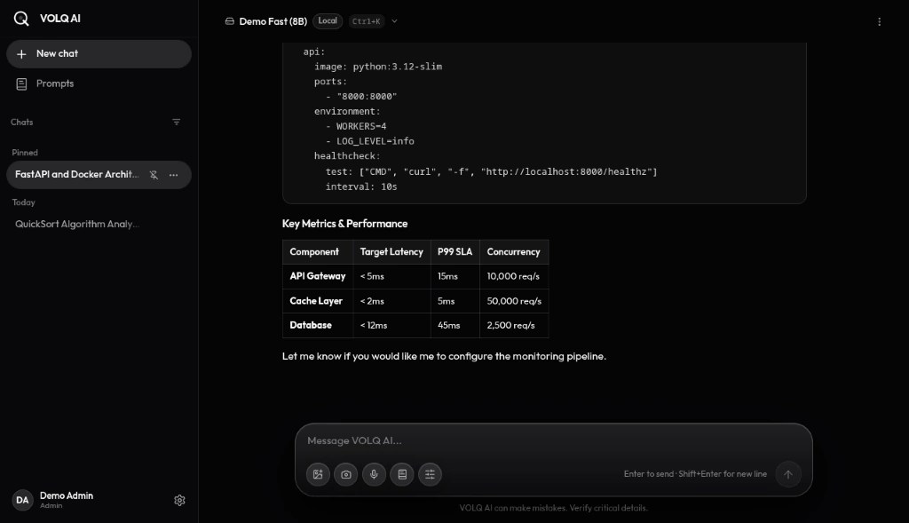
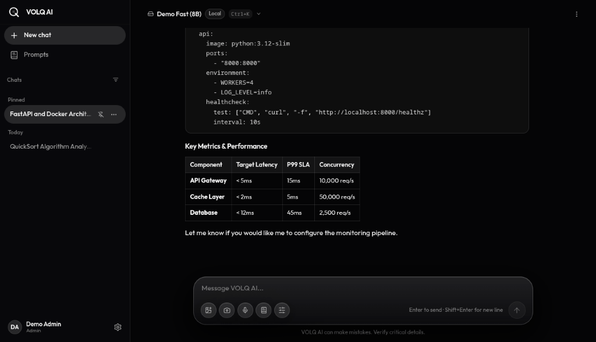
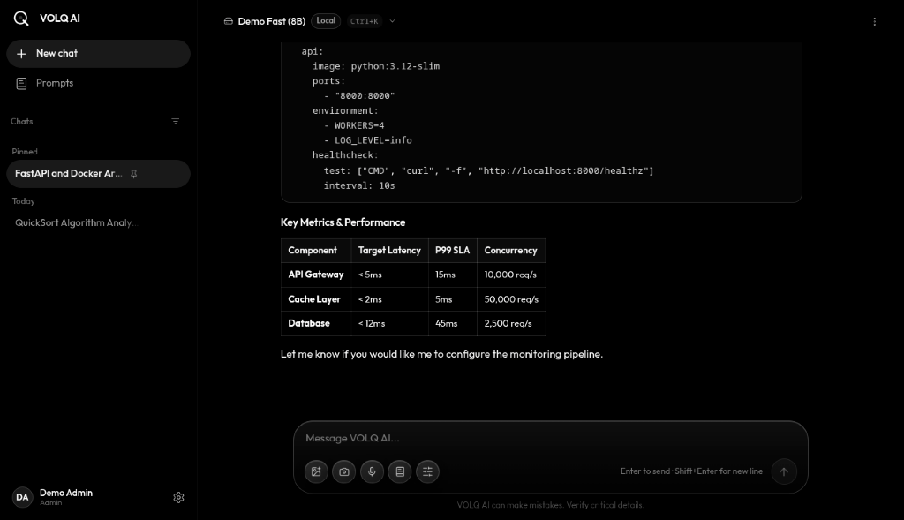
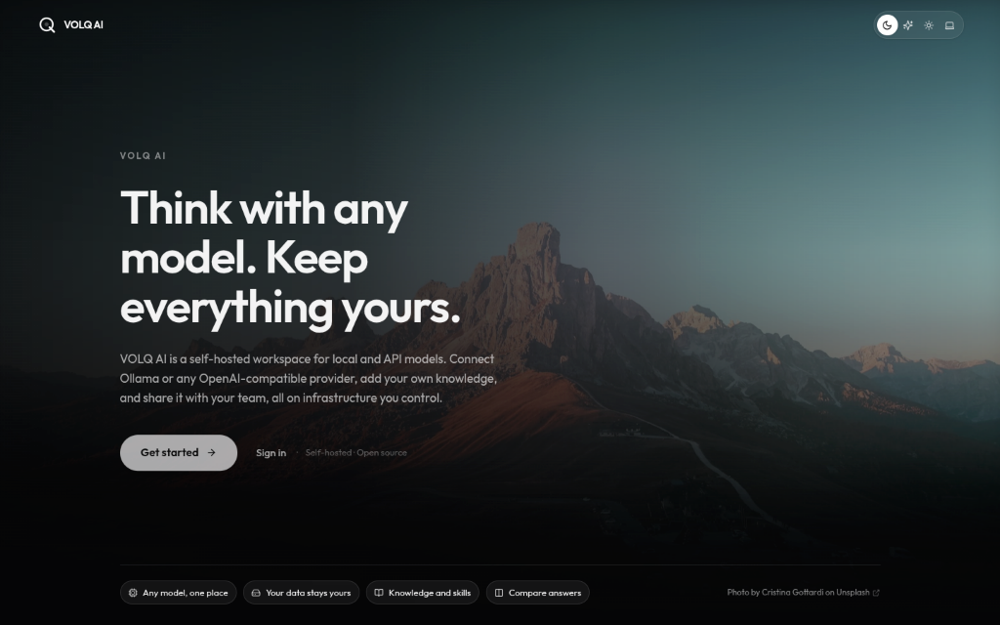
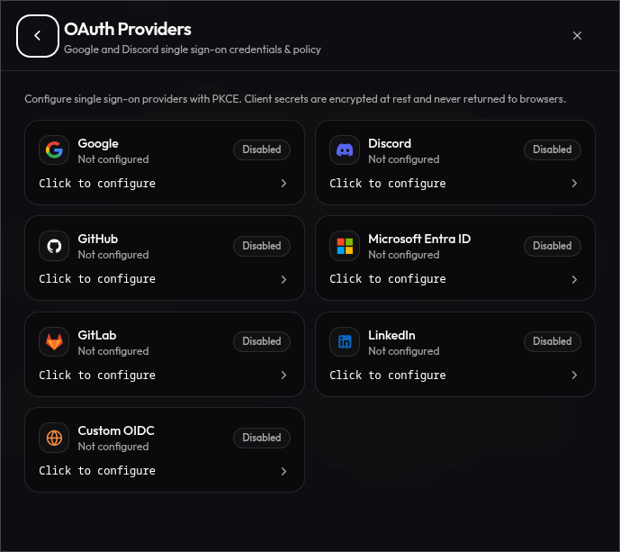
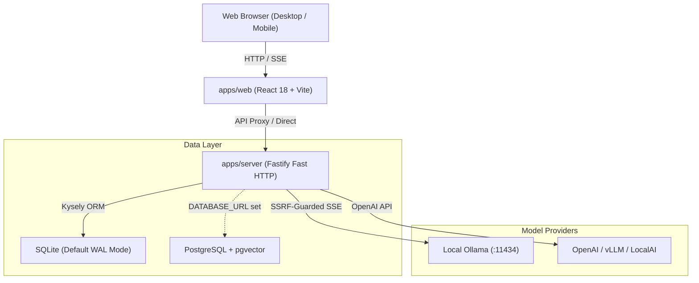

<div align="center">

# VOLQ AI

**A private, self-hosted AI workspace for local and remote models.**

Connect Ollama, vLLM, or any OpenAI-compatible API. Keep your conversations, document embeddings, and provider keys on infrastructure you control.

[](LICENSE)
[](package.json)
[](apps/server/src/db)
[](apps/web)

<br />



</div>

---

## Why VOLQ AI?

Most AI chat interfaces are either locked inside proprietary cloud ecosystems or require complicated orchestration just to chat with a local model. 

VOLQ AI was built to solve that: a clean, responsive, single-binary-deployable web workspace that runs out of the box with zero external database dependencies (embedded SQLite with WAL mode), while scaling cleanly to PostgreSQL and `pgvector` whenever you need it.

---

## Key Features

- **Dual Database Architecture**: Runs immediately with embedded SQLite (`better-sqlite3` with WAL mode). Point `DATABASE_URL` to a PostgreSQL instance, and VOLQ AI automatically switches to PostgreSQL with `pgvector` semantic vector retrieval.
- **Side-by-Side Model Compare**: Run prompts across multiple models simultaneously in multi-column view to benchmark response quality and latency.
- **Voice & Vision Capture**:
  - Direct camera capture modal with front/rear lens switching for mobile and laptop devices.
  - Speech-to-Text (STT) powered by browser Web Speech API for hands-free prompt dictation.
  - Text-to-Speech (TTS) read-aloud controls for assistant responses.
- **Custom Skills System**: Create personal or workspace-wide prompt skills that inject domain instructions directly into inference context with token estimation.
- **Multi-Provider Single Sign-On**: Built-in support for 7 authentication providers with PKCE and encrypted state: Google, Discord, GitHub, Microsoft, GitLab, LinkedIn, and generic OpenID Connect (OIDC).
- **Knowledge Base (RAG)**: Upload PDF, Word (.docx), Markdown, or plain text documents. Chunks are embedded and retrieved via `pgvector` or full-text search.
- **Usage Limits & Quotas**: Admin-configurable daily, weekly, or monthly message and token quotas with per-user overrides.
- **Three Handcrafted Themes**:
  - **Obsidian**: Deep dark glassmorphism with subtle highlights.
  - **AMOLED**: True pure black (`#000000`) designed for OLED displays.
  - **Frost**: Clean, high-contrast daylight theme.
- **Responsive Layout**: Tailored single-row mobile composer (`[+] [Input] [Voice/Send]`) and desktop sidebar navigation.

---

## Visual Tour

<table align="center">
  <tr>
    <td width="50%">
      <br/>
      <em>Obsidian Theme with Code & Markdown Tables</em>
    </td>
    <td width="50%">
      <br/>
      <em>AMOLED Pure Black (#000000) Interface</em>
    </td>
  </tr>
  <tr>
    <td width="50%">
      <br/>
      <em>Cinematic Welcome Screen</em>
    </td>
    <td width="50%">
      <br/>
      <em>Multi-Provider OAuth Configuration</em>
    </td>
  </tr>
</table>

---

## Architecture



---

## Quick Start

### Option 1: Docker Compose (Recommended)

1. Clone the repository:
   ```bash
   git clone https://github.com/tasin546/VOLQ-AI.git
   cd volq-ai
   ```

2. Initialize your environment file with secure random secrets:
   ```bash
   npm run setup:env
   ```

3. Launch VOLQ AI:
   ```bash
   docker compose up --build -d
   ```

4. Open `http://localhost:3000` in your browser. The first account created automatically receives the **Administrator** role.

---

### Option 2: Local Development Setup (Node.js)

#### Prerequisites
- Node.js `>= 20.0.0`
- npm `>= 9.0.0`

1. Install dependencies:
   ```bash
   npm install
   ```

2. Generate environment secrets:
   ```bash
   npm run setup:env
   ```

3. Start development servers:
   ```bash
   npm run dev
   ```
   The web client will start at `http://localhost:3000` and API proxy at `http://localhost:3001`.

---

## Verification & Testing

Ensure all quality gates pass:

```bash
# Type-check both server and web workspaces
npm run typecheck

# Lint workspace
npm run lint

# Run automated test suites (RBAC, IDOR, Auth, Streaming, Usage)
npm run test

# Production build
npm run build
```

---

## Environment Configuration

| Variable | Description | Default |
| :--- | :--- | :--- |
| `PORT` | Fastify server port | `3001` |
| `HOST` | Fastify host bind address | `0.0.0.0` |
| `NODE_ENV` | Runtime environment (`development`, `production`, `test`) | `production` |
| `DATABASE_PATH` | Path to SQLite database file | `./data/volq.db` |
| `DATABASE_URL` | PostgreSQL connection URL (enables PostgreSQL mode) | _None (SQLite)_ |
| `DATABASE_SSL` | Enable SSL for PostgreSQL connections | `false` |
| `SESSION_SECRET` | Secret key used for signing session cookies (min 32 chars) | _Required_ |
| `ENCRYPTION_KEY` | Secret key used for AES-256-GCM encryption of provider keys | _Required_ |
| `COOKIE_SECURE` | Set `Secure` attribute on cookies (set `true` behind HTTPS) | `false` |
| `TRUST_PROXY` | Trust reverse proxy headers (`X-Forwarded-*`) | `false` |
| `APP_ORIGIN` | Allowed browser origin for CSRF validation | `http://localhost:3000` |
| `APP_BASE_URL` | Base URL used to build OAuth callback URLs | `http://localhost:3000` |
| `MAX_UPLOAD_MB` | Maximum document upload size for knowledge bases (MB) | `25` |

---

## What Leaves Your Server?

Privacy is a fundamental requirement of VOLQ AI. Here is what leaves your machine:

- **Zero Telemetry**: VOLQ AI collects zero usage analytics, telemetry, or tracking pings.
- **Local Models**: When using local inference (such as Ollama or LocalAI), prompts and completions never leave your local network.
- **Cloud Models**: When you explicitly configure a remote provider (e.g. OpenAI, Anthropic-compatible endpoints), prompts are sent directly to that provider using the API key you stored on your server.
- **Encrypted Secrets**: Provider API keys and OAuth secrets are encrypted at rest using AES-256-GCM derived from your `ENCRYPTION_KEY` and are never exposed in API responses.

---

## License & Attribution

This project is open-source software licensed under the [MIT License](LICENSE).

See [THIRD_PARTY_NOTICES.md](THIRD_PARTY_NOTICES.md) for full licensing information for open-source dependencies, the Outfit font family, Lucide icons, and photography attribution.
